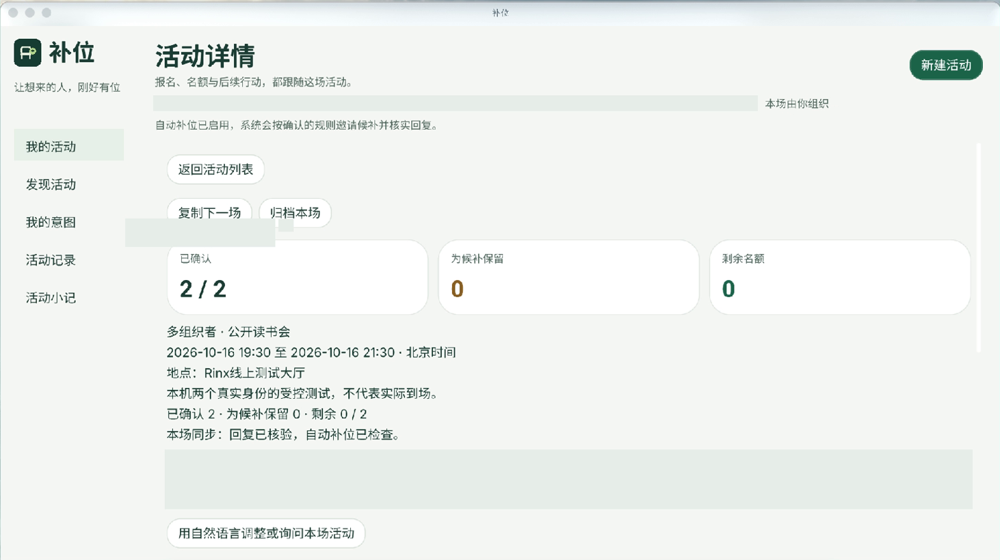

# 补位 BuWei

让想来的人，刚好有位。

补位帮助运动、户外、文娱、学习交流、聚餐和公益等社群活动的组织者持续跟进报名、候补和临时补位。
组织者保存想办成的活动，成员保存想参加的安排；补位发现相关变化、准备下一步，并沿原操作编号核实结果。

作者 **WeiR-h** · 队伍 **生生不息** · Apache-2.0

## 实际效果

一句话准备策划，确认后发布活动。成员自主挑选和报名，组织者持续跟进结果。

- 每个账号同时接入最多五场活动，每场最多 30 个名额；支持完整日期、分钟和跨午夜时段。
- 18 个可搜索活动模板覆盖跑步、徒步、骑行、球类、读书会、聚餐、工作坊和亲子等场景，提供对应流程与准备清单，也可自定义。[活动类型与使用方法](docs/ACTIVITY-TYPES.md)
- 同一个账号可以组织活动，也可以参加其他人的活动，按本场身份显示操作和名单权限。
- 同行 1–8 人整组报名。名额不足时保留排位，人数合适时再邀请。
- 确认本场规则后自动补位，分别显示名额保留、邀请送达和本人接受。
- “我的目标”保存本次安排和本人确认的长期偏好，主动提示人数缺口、合适活动、待回复邀请及时间冲突。
- 建议衔接持续任务；修改或暂停目标后，旧预览停止执行，已有回执保留用于恢复。
- AI 帮助生成活动草稿、理解报名、解释候补和准备有事实依据的活动小记。
- 一句话准备活动策划，补齐缺项后确认创建；流程、准备事项和招募文案可以继续编辑。
- 从公开大厅或本人社群挑选活动，加入后直接准备报名，核对时间与人数再确认。
- 组织者查看已核验的报名名单，导出可由 Excel 打开的 CSV。
- 发送中断后沿原操作编号核实结果，避免重复邀请或发布。



## 下载

[下载 v0.2.13 Windows 活动类型验证版](https://github.com/WeiR-h/buwei/releases/tag/v0.2.13) · [正式版](https://github.com/WeiR-h/buwei/releases/latest)

**v0.2.13 活动类型验证版**使用官方桌面 RC6，增加 18 个可搜索模板，把对应流程、准备事项与参加须知保存为策划稿，并贯通推荐、发现和名单导出。

应用使用官方 OctoSense 桌面 RC6 与 Rinx 1.1.0 的固定源码，提供组织者和参与者入口。成员使用自己的 Rinx 身份报名和回复，组织者核验结果后显示最终报名状态。

用户可主动开启 Windows 托盘值守；电脑与程序运行且授权有效时继续同步。反馈只修改本人选择的范围，下一场筹备生成可编辑草稿，日期、地点和人数重新确认。

[目标、主动建议与值守](docs/INTENTIONS.md) · [参赛与历史版本](docs/SUBMISSION.md)

[活动策划、社群报名与名单导出](docs/COMMUNITY.md)

[活动库与社群使用演示（v0.2.13）](https://github.com/WeiR-h/buwei/releases/download/v0.2.13/BuWei-v0.2.13-demo.mp4)：查看活动模板、准备可编辑策划、按类型挑选社群活动与跟进报名结果。演示来自实际 Windows 程序，私密标识已遮盖。

[报名、邀请与接受的 60 秒连续实录（v0.2.12）](https://github.com/WeiR-h/buwei/releases/download/v0.2.12/BuWei-v0.2.12-demo.mp4)：本机两个真实账号完成自然语言报名、规则邀请、本人接受与组织者最终核验。

[策划、社群发布与导出流程演示（v0.2.11）](https://github.com/WeiR-h/buwei/releases/download/v0.2.11/BuWei-v0.2.11-Demo.mp4) · [源码、服务与恢复验证记录](docs/VERIFICATION.md)

运行环境：Windows 10/11 x64，微软 Visual C++ v14 x64 运行库。
发布形式为 Windows 原生宿主扩展。

## 三步开始

1. 解压运行包，打开“启动补位”，在 Rinx 完成本人登录。另两个入口用于分别保存两个账号的资料。
2. 打开补位，核对账号并确认所需权限。
3. 描述想办的活动并确认创建、发布；或进入“发现活动”挑选一场，核对本人报名，收到邀请后确认接受。

[使用指南](docs/FIRST-RUN.md) · [隐私说明](docs/PRIVACY.md)

[三身份读书会试用](docs/READING-TRIAL.md)

## 源码构建

```powershell
git clone https://github.com/WeiR-h/buwei.git
cd buwei
python tools/bootstrap.py
./tools/Build.ps1 -Tests
./tools/Build.ps1 -Release
```

构建需要 Windows x64、Git、Python 3.12+、Rust 1.98.0、Visual Studio C++ 桌面工具和 Windows SDK。
首次构建会获取固定版本的官方依赖。运行与模型配置步骤见使用指南。

核心包含可复用的授权、持久化执行与回执框架，应用源码和必要的构建补丁完整提供。

[独立复验、性能测量与真实服务验证](docs/VERIFICATION.md)

[English](README.en.md) · [版本记录](CHANGELOG.md) · [第三方声明](NOTICE.md) ·
[问题反馈](https://github.com/WeiR-h/buwei/issues) · [参赛说明](docs/SUBMISSION.md)
